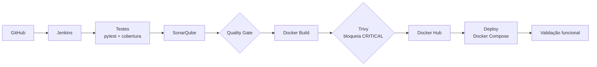

# CitizenTech – API de Ocorrências Urbanas

### Pipeline DevSecOps CI/CD · FIAP Global Solution 2026 – DevOps & DevSecOps Challenge

**Disciplina:** DevOps CI-CD · **Turma:** 2TCNPZ


---

## 👥 Integrantes

| Nome | RM |
|---|---|
| Nickolas Corazza | RM562265 |
| Gabriel Lamata | RM562093 |
| Luiz Parpinelli | RM566493 |
| Dorivaldo Nascimento | RM565225 |

---

## 📌 Sobre o projeto

O **CitizenTech** é uma API REST em **FastAPI** para o registro e a consulta de **ocorrências urbanas** (buracos, falhas de iluminação, descarte irregular etc.), conectando o cidadão ao poder público.

O foco do trabalho não é a aplicação em si, e sim a **pipeline DevSecOps** que leva o código do GitHub até o deploy validado, com testes, análise estática, varredura de vulnerabilidades e bloqueios automáticos.

> **Opção A do enunciado (projeto próprio).** A aplicação foi desenvolvida pela equipe, inspirada apenas na ideia do CivicLens. **Nenhum código do CivicLens foi copiado ou incorporado.**

### Fluxo da pipeline



---

## 🧱 Stack e ambiente

| Camada | Tecnologia |
|---|---|
| Aplicação | Python, FastAPI, Pydantic, Uvicorn |
| Testes | pytest, pytest-cov, httpx (TestClient) |
| CI/CD | Jenkins 2.541.3 (Pipeline as Code, `Jenkinsfile`) |
| Qualidade | SonarQube Community Build + SonarScanner CLI 8.4 |
| Segurança | Trivy (varredura da imagem) |
| Contêineres | Docker, Docker Compose, Docker Hub |
| Ambiente | Windows, PowerShell, Docker Desktop (WSL2) |

---

## 📁 Estrutura do repositório

```text
.
├── app/
│   ├── __init__.py
│   └── main.py                  # API FastAPI
├── tests/
│   ├── __init__.py
│   └── test_main.py             # Testes automatizados
├── infra/
│   ├── Dockerfile.jenkins       # Jenkins com Docker CLI, Python e Trivy
│   └── docker-compose.infra.yml # Jenkins + SonarQube + PostgreSQL
├── Dockerfile                   # Imagem da aplicação
├── docker-compose.yml           # Execução local e deploy
├── Jenkinsfile                  # Pipeline declarativa
├── sonar-project.properties     # Configuração do SonarQube
├── pytest.ini
├── requirements.txt
├── requirements-dev.txt
├── .dockerignore
├── .gitignore
├── .gitattributes
└── README.md
```

---

## 🔌 Endpoints

| Método | Rota | Descrição | Respostas |
|---|---|---|---|
| GET | `/health` | Status da aplicação | 200 |
| GET | `/ocorrencias` | Lista as ocorrências | 200 |
| GET | `/ocorrencias/{id}` | Detalha uma ocorrência | 200, 404 |
| POST | `/ocorrencias` | Cria uma ocorrência | 201, 422 |

Documentação interativa (Swagger): `http://localhost:8000/docs`

Exemplo de criação:

```powershell
curl -X POST http://localhost:8000/ocorrencias `
  -H "Content-Type: application/json" `
  -d '{"titulo":"Buraco na rua","descricao":"Buraco grande na Av. Paulista","categoria":"via"}'
```

---

## ▶️ Como executar

### Local (sem Docker)

```powershell
python -m venv .venv
.\.venv\Scripts\Activate.ps1
pip install -r requirements-dev.txt
python -m pytest
uvicorn app.main:app --reload
```

### Com Docker Compose

```powershell
docker compose up -d --build
curl http://localhost:8000/health
```

### Imagem publicada

```powershell
docker run -d -p 8000:8000 corazza012/civictech-api:latest
```

---

## ⚙️ Pipeline (Jenkinsfile)

| # | Estágio | O que faz |
|---|---|---|
| 1 | **Checkout** | Obtém o código e define a tag `BUILD_NUMBER-SHA` (ex.: `28-81a6af3`) |
| 2 | **Testes automatizados** | pytest com cobertura (JUnit + `coverage.xml`) |
| 3 | **Análise SonarQube** | `sonar-scanner` no projeto `civictech-api` |
| 4 | **Quality Gate** | `waitForQualityGate abortPipeline: true` (perfil padrão "Sonar way") |
| 5 | **Docker Build** | Gera `corazza012/civictech-api:<tag>` e `latest` |
| 6 | **Trivy** | Relatórios HIGH+CRITICAL arquivados; **reprova se houver CRITICAL** |
| 7 | **Publicação da imagem** | Push no Docker Hub com credencial do Jenkins |
| 8 | **Deploy** | `docker compose -p civictech up -d` |
| 9 | **Validação funcional** | `GET /health` e `GET /ocorrencias` |

**Gatilho automático:** `pollSCM('H/2 * * * *')`, mecanismo equivalente a webhook, aceito pelo enunciado.

### Decisões de projeto

- **Trivy em duas passadas:** primeiro gera os relatórios completos (HIGH + CRITICAL, texto e JSON) sem bloquear; depois executa a varredura só de CRITICAL com `--exit-code 1`, que bloqueia. Não foi usado `--ignore-unfixed`, para não esconder vulnerabilidades sem correção.
- **Quality Gate sem enfraquecimento:** perfil padrão "Sonar way".
- **Segredos somente no Jenkins Credentials**, nunca no repositório.
- **Validação via `host.docker.internal`**, porque `localhost` dentro do contêiner do Jenkins não é o host.

---

## 🏗️ Infraestrutura (Jenkins + SonarQube)

```powershell
cd infra
docker compose -f docker-compose.infra.yml up -d --build
```

| Serviço | Porta |
|---|---|
| Jenkins | 8080 |
| SonarQube | 9000 |
| Aplicação | 8000 |

**Pré-requisito no Windows/WSL2 para o SonarQube** (perde-se ao reiniciar o Docker Desktop):

```powershell
wsl -d docker-desktop sysctl -w vm.max_map_count=262144
```

### Configuração no Jenkins (sem segredos no repositório)

| Item | Nome / valor |
|---|---|
| Credencial *Secret text* | `sonar-token` |
| Credencial *Username/password* | `dockerhub-creds` (usuário Docker Hub + Access Token Read & Write) |
| Servidor SonarQube | `sonarqube` → `http://sonarqube:9000` (variáveis de ambiente habilitadas) |
| Ferramenta | `SonarScanner` (instalação automática) |
| Plugins | SonarQube Scanner, Docker Pipeline, Pipeline Stage View, Credentials Binding |
| Job | `civictech-pipeline` (Pipeline script from SCM, branch `main`, `Jenkinsfile`) |

**Webhook no SonarQube** (barra final obrigatória): `http://jenkins:8080/sonarqube-webhook/`

---

## 📊 Resultados

### Testes automatizados

- **4 testes aprovados**, **97% de cobertura** (`app/main.py`).
- Aviso `StarletteDeprecationWarning` (httpx → httpx2): depreciação de dependência, vem do `site-packages`, sem impacto no código da equipe.

### SonarQube

- Análise concluída com sucesso no projeto `civictech-api`.
- **Quality Gate: OK** (perfil "Sonar way", com webhook para o Jenkins).

### Trivy (imagem de produção, build #28)

- **0 CRITICAL** e **49 HIGH**, todos no sistema base Debian (zlib1g, util-linux, libsystemd0, perl-base, ncurses, entre outros).
- Dos 49 HIGH, **2 têm correção disponível** (zlib1g) e **47 não têm correção publicada** (`affected` / `fix_deferred`).
- As dependências Python da aplicação não apresentaram vulnerabilidades.
- Relatórios completos arquivados em cada build: `trivy-report.txt` e `trivy-report.json`.

---

## 🛡️ Controles de segurança demonstrados

A equipe provou, com falhas **controladas e intencionais**, que a pipeline realmente bloqueia:

| Controle | Build vermelho | Recuperação | Prova de bloqueio |
|---|---|---|---|
| **Falha de teste** | #24 (`POST` retornando 200 em vez de 201; 7 estágios não executados) | #25 (`git revert`) | Tag `24-060d0a1` **não existe** no Docker Hub |
| **Trivy CRITICAL** | #27 (estágio Trivy reprovado: 3 CRITICAL, sendo 2 Debian e 1 Python) | #28 (`git revert`) | Tag `27-3fc1b0d` **não existe** no Docker Hub |

Observações:

- Os builds #24, #25, #26, #27 e #28 foram disparados automaticamente (`Started by an SCM change`).
- No #27 foi usada **temporariamente** uma imagem base antiga e vulnerável (`python:3.8-slim-buster`), revertida no commit seguinte. **A imagem de produção não contém vulnerabilidades CRITICAL.**
- Em ambas as falhas, nenhuma imagem foi publicada e o container em execução permaneceu na versão anterior.

---

## 🔧 Troubleshooting

Histórico completo: **28 builds, 24 falhas e 4 sucessos**. Recorte relevante (#18 a #28): **11 builds, 7 falhas e 4 sucessos**.

| Builds | Tipo | Sintoma | Causa raiz | Correção |
|---|---|---|---|---|
| #1 a #17 | Hipótese incorreta | `NoSuchMethodError: No such DSL method 'pipeline'` | Diagnóstico inicial apontava para plugins; a causa real era outra | Reinstalações e reinícios não resolveram |
| #18 | Incidente real | `NoSuchMethodError` ao ler o Jenkinsfile | **BOM UTF-8** (`EF BB BF`) no início do arquivo | Regravar sem BOM; confirmado com `Format-Hex` (commit `1a17a94`) |
| #19 | Incidente real | `ModuleNotFoundError: No module named 'app'` | pytest sem o diretório raiz no `pythonpath` | `python -m pytest` + `pytest.ini` (commit `86aff55`) |
| #20, #21, #22 | Incidente real | `push access denied` / `insufficient_scope` | `IMAGE_NAME` com namespace `ncorazza12`, login feito como `corazza012` | `IMAGE_NAME = corazza012/civictech-api` e credencial atualizada (commit `5857268`) |
| #24 | Falha controlada | Teste falha, pipeline interrompida | Teste quebrado de propósito (Etapa 6) | `git revert` → #25 verde |
| #27 | Falha controlada | Trivy reprova a imagem | Imagem base antiga com CRITICAL (demonstração) | `git revert` → #28 verde |

**Método do diagnóstico do #20 a #22:** push de teste para `ncorazza12/teste-push` (falhou) e para `corazza012/teste-push` (funcionou), isolando o problema no namespace.

**Aprendizado principal:** inspecionar os bytes do arquivo (`Format-Hex`) resolveu em um build o que 17 tentativas de reinstalar plugins não resolveram.

---

## ⚠️ Limitações conhecidas

- O Jenkins roda como `root` com `docker.sock` montado, para permitir `docker build`. É aceitável em laboratório, mas **não recomendado em produção**.
- Os testes rodam em **Python 3.13** no Jenkins, enquanto a imagem e o `sonar.python.version` usam **3.12**.
- A imagem base Debian possui 49 HIGH, sendo 47 sem correção publicada. Optou-se por não aplicar `apt-get upgrade`, pois resolveria só 2 e não altera o status de segurança (0 CRITICAL).
- Dependências não fixadas em `requirements.txt` (reprodutibilidade parcial).
- Arquivos `.pyc` do commit inicial permanecem no histórico do Git (já removidos da árvore e ignorados); o histórico não foi reescrito de propósito.
- Gatilho por `pollSCM`, e não por webhook do GitHub, por não haver URL pública no ambiente local.

---

## 🔗 Links

| Recurso | Link |
|---|---|
| Repositório GitHub | https://github.com/ncorazza12/DevOps_GS |
| Imagem no Docker Hub | https://hub.docker.com/r/corazza012/civictech-api |
| Post no LinkedIn | _(inserir)_ |
| Vídeo demonstrativo | _(inserir)_ |

---

## 📄 Licença e créditos

Código desenvolvido pela equipe para fins acadêmicos (FIAP). Nenhum código do CivicLens foi incorporado; o projeto serviu apenas como inspiração temática.
